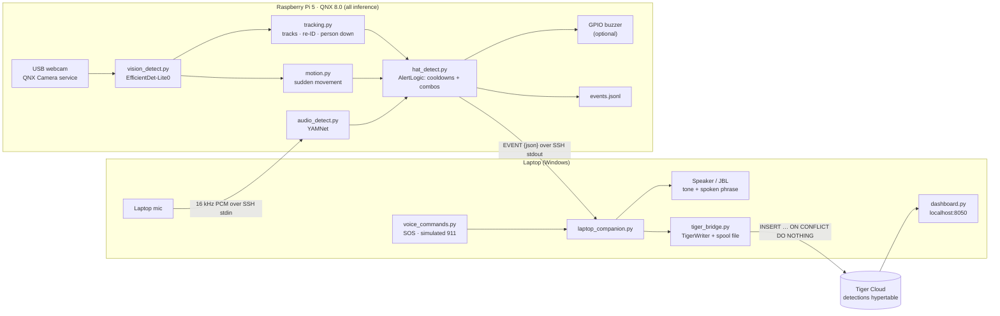

# Hat Detect ("Super Safety Hat")

**Hack Western 13 · QNX track**

[](https://www.youtube.com/watch?v=xk0N_-TmEuw&t=8s)

- **Demo video:** https://www.youtube.com/watch?v=xk0N_-TmEuw&t=8s
- **Devpost:** https://devpost.com/software/super-safety-hat

Hat Detect is a construction hard hat with a camera on the back and a microphone. It watches
the area behind the wearer and listens for danger. Two TensorFlow Lite models run on a
**Raspberry Pi 5 running QNX Neutrino 8.0**: YAMNet for sound and EfficientDet-Lite0 for
objects. When something needs attention, the hat warns the wearer out loud, for example
"Warning! Horn and truck behind you on your left, closing in, about 2 seconds away". Every
detection is stored in **Tiger Data** (Tiger Cloud / TimescaleDB), and a site dashboard
shows what every hat has seen.

## The problem

On a construction site, a worker can't see behind them, and hearing protection plus constant
noise make it easy to miss a horn, a reversing beeper or a co-worker shouting. Hat Detect is
an extra pair of eyes and ears. It runs on the hat itself, so it keeps working without a
network connection.

---

## How it works



### 1. Why there's a laptop

All detection runs on the Pi. The laptop is there only for hardware the QNX image can't use:
the image has no Bluetooth stack, so it can't drive the JBL speaker, and its USB audio driver
rejects the webcam's microphone. The laptop therefore lends its mic and speaker. It is also
the only machine that holds the database password, so the Pi never connects to Tiger Cloud.

`scripts/laptop_companion.py` opens one SSH session to the Pi and runs
`python3 -u hat_detect.py` there. The session carries data both ways:

- **Laptop → Pi (stdin):** raw 16-bit, 16 kHz mono microphone audio.
- **Pi → laptop (stdout):** one `EVENT {json}` line for each detection.

When the laptop closes the connection, the audio stream ends and the Pi shuts down cleanly. It
stops the camera recorder and deletes its temporary file.

### 2. Audio pipeline (`audio_detect.py`)

- Audio is buffered into 0.975 s windows (15,600 samples, YAMNet's fixed input) and classified
  every 0.5 s (`audio.hop_seconds`).
- YAMNet scores 521 AudioSet classes. Hat Detect maps the relevant ones into safety groups:

  | Group | Example YAMNet classes |
  |---|---|
  | `ALARM` | Alarm, Fire alarm, Smoke detector, Reversing beeps, Beep/bleep |
  | `SIREN` | Siren, Police car, Ambulance, Fire engine |
  | `HORN` | Vehicle horn, Air horn/truck horn, Foghorn |
  | `VOICE` | Shout, Yell, Screaming, Crying, Groan |
  | `IMPACT` | Smash/crash, Breaking, Explosion, Bang, Slam, Thump |
  | `GLASS` | Glass, Shatter |
  | `GUNSHOT` | Gunshot, Machine gun, Artillery fire |
  | `SKID` | Skidding, Tire squeal |
  | `FIRE` | Fire, Crackle |
  | `MACHINERY` | Chainsaw, Jackhammer, Power tool, Drill (60 s cooldown, as a reminder) |

- A class counts when its score reaches `audio.threshold` (0.3). Only the strongest class in
  each group is reported per window. Ordinary site sounds (hammer, engine, speech) are
  recognised but never raise an alert.
- YAMNet takes about 6 ms per window on the Pi 5 (XNNPACK, 4 threads).

### 3. Vision pipeline (`vision_detect.py`, `tracking.py`, `motion.py`)

**Camera capture on QNX.** There's no OpenCV camera access on the Pi, so `vision_detect.py`
drives the stock QNX `camera_example4_record` tool. The tool records an uncompressed `.ucv`
file from camera unit 5 (the USB webcam) at 5 fps. Python reads the newest complete frame
from that file as it grows and converts YUY2 to RGB with numpy. The recording restarts every
30 s and the old file is deleted, so the SD card doesn't fill up.

**Object detection.** Each frame is resized to 320×320 and run through EfficientDet-Lite0
(about 55 ms, or 85 ms including the resize). Detections at or above `video.threshold` (0.5)
are mapped to groups:

| Group | COCO classes |
|---|---|
| `PERSON` | person |
| `VEHICLE` | car, truck, bus, motorcycle, bicycle, train |
| `SHARP` | knife, scissors |

**Tracking (`tracking.py`).** Without tracking, a person standing behind you would trigger an
alert on every frame. The tracker:

1. Matches each detection to an existing track by box overlap (IoU), falling back to
   distance between box centres.
2. **Re-identifies** people who leave and come back. Each track stores a colour histogram of
   the torso (clothing). If someone returns within `memory_s` (120 s) and their colours match
   (`reid_min` 0.6), they get their old ID and don't trigger a new alert.
3. Fits recent box positions and sizes to classify **motion**: approaching, moving away,
   crossing left or right, still or steady. For anything approaching, the rate at which its box
   grows gives an estimated **time to reach the wearer** (time to contact, TTC).
4. Raises **incidents**. Each one fires once, then re-arms when the condition clears:
   - `NEW`: a new person, announced at once. A new vehicle is announced after a short
     settling period unless it's moving away.
   - `CLOSE`: the box fills at least 35% of the frame, so something is right behind you.
   - `APPROACH`: the box grows 1.8× quickly, or the time to contact is 3 s or less.
   - `DOWN`: a person seen standing becomes wide and low in the frame for 2 s (a fall).
   - `LYING`: a person stays wide, low and still for 5 s, even if the fall wasn't seen.

   Incidents map to alert groups: `DOWN` and `LYING` become `PERSON_DOWN`. `CLOSE` and
   `APPROACH` become `PERSON_CLOSE` for a person, or a `VEHICLE` alert for a vehicle.

**Sudden movement (`motion.py`).** This catches things the detector has no label for, such
as a falling load or a swinging hook. It compares each frame with the previous one at 80×60
greyscale and ignores movement inside boxes of tracked people and vehicles. It alerts (`MOTION`)
when at least 6% of the frame suddenly changes after a quiet second. If more than 45% of the
frame changes at once, the wearer turned their head, so it's ignored. Movement in the top of
the frame is labelled "movement overhead".

### 4. Alert logic and audio-visual fusion (`hat_detect.py`)

Audio and video run in separate threads and send every detection to one `AlertLogic` object:

1. **Event.** Each detection becomes an event with `time` (UTC ISO 8601), `device_id`,
   `source` (`audio`, `video` or `combined`), `group`, `label`, `score`, `position`
   (left, centre or right), `bbox` and `alerted`. Video events can also carry `track`,
   `incident`, `motion`, `ttc` and `people`.
2. **Cooldown.** An event alerts only if its group hasn't alerted in the last 3 s
   (`alerts.cooldown_seconds`; `MACHINERY` uses 60 s). Tracked people and vehicles alert only
   on incidents, never on every frame.
3. **Fusion.** After each event, the logic checks whether a matching event from the other
   sense happened recently. If so, it emits one stronger combined event:

   | Heard | Seen | Becomes | Window |
   |---|---|---|---|
   | Horn, siren or skid | Vehicle | `COMBINED` | 2 s |
   | Reversing beeps | Vehicle | `COMBINED` | 2 s |
   | Crash or shout | Person down | `INJURY` | 8 s |
   | Crash or glass | Sudden movement | `FALLING_OBJECT` | 3 s |

   The combined event's score is the lower of the two original scores, and it keeps the
   visual position, motion and time to contact.
4. **Severity** comes from the hazard group, not the model's confidence (`alerts.severity` in
   `hat_config.json`):
   - **High:** `COMBINED`, `INJURY`, `FALLING_OBJECT`, `PERSON_DOWN`, `ALARM`, `SIREN`,
     `IMPACT`, `FIRE`, `GUNSHOT`, `SKID`.
   - **Medium:** `HORN`, `VOICE`, `GLASS`, `VEHICLE`, `SHARP`, `PERSON_CLOSE`, `MOTION`.
   - **Low:** `PERSON`, `MACHINERY`.
5. **Output.** Every event is appended to `~/hatdetect/events.jsonl` on the Pi and printed as
   an `EVENT` line. Alerts also pulse the optional GPIO buzzer on BCM 18: three beeps for
   high, two for medium, one for low. The newest alert replaces any pattern still waiting.

### 5. Warning the wearer (`scripts/laptop_companion.py`)

For each event with `alerted: true`, the companion:

- plays a tone that depends on severity (high: 3 beeps at 1400 Hz, medium: 2 at 1000 Hz,
  low: 1 at 800 Hz), then
- speaks a phrase with the Windows built-in voice (System.Speech through PowerShell) on the
  default output device. Pair the JBL speaker and make it the default.

Phrases are built from the event. Because the camera faces backwards, left and right are
flipped so they're from the wearer's point of view (`--camera-facing front` turns this off).
Examples:

- `Warning! Siren and truck behind you on your right, closing in, about 2 seconds away`
- `Warning! Person down right behind you`
- `Two people behind you on your left, crossing`
- `Watch out! Something falling behind you`

Alerts play one at a time. An alert that waited more than 4 s in the queue is dropped, so the
wearer never hears outdated warnings.

### 6. Voice commands (`scripts/voice_commands.py`)

The Windows offline speech recogniser listens for a fixed list of phrases. Decoy words such as
"hello" and "helmet" keep it from mishearing ordinary talk as a command. It pauses while the
hat is speaking.

- **"help help"** or **"I need help"**: stores an `SOS` event, which shows as a red emergency
  banner on the dashboard.
- **"call nine one one"**, then **"confirm"** within 10 s: places a **simulated** 911 call.
  Nothing is dialled. The companion prints the message it would send to dispatch (worker,
  zone and recent alerts) and stores an `EMERGENCY_CALL` event. "cancel" stops it.

### 7. Storing events in Tiger Data (`scripts/tiger_bridge.py`, `db/schema.sql`)

The companion passes every event, whether it alerted or not, to `TigerWriter`:

- Events are batched for up to 1 s and inserted into the `detections` hypertable.
- If Tiger Cloud is unreachable, the batch is written to `.tiger_spool.jsonl` and retried
  every 10 s. Adding an event never blocks, so alerts keep playing offline.
- A unique index on `(device_id, source, label, time)` with `ON CONFLICT DO NOTHING` means
  replayed or re-sent events are never stored twice.

The database schema contains:

| Object | Purpose |
|---|---|
| `detections` | Every event from every hat. Hypertable partitioned on time, 90-day retention. |
| `hazard_types` | Hazard register: one row per group with source, severity, description and the recommended control (for example "Stop and step clear of the vehicle path"). |
| `detections_per_minute` | Continuous aggregate (per-minute counts) used by the dashboard's charts. |
| `safety_alerts` | View: alerted detections joined with their recommended control. |
| `workers` | Who wears each hat: name, role and zone. |
| `supervisor_activity`, `supervisor_activity_history` | Supervisor log of inspections and corrective actions (`db/activity_log.sql`). |

The Pi also keeps its own `events.jsonl`, so events recorded without a laptop can be loaded
later with `python scripts/tiger_bridge.py ingest-pi`.

### 8. Dashboard (`scripts/dashboard.py`, `scripts/dashboard.html`)

The dashboard is a small Python web server on `localhost:8050` that queries Tiger Cloud. The
browser page polls it every 5 s. The database password stays on the laptop.

- **Site overview:** every worker ranked by risk (5 × high + 2 × medium + low alerts), with
  per-zone counts, an alert timeline and red banners for SOS or 911 events from the last
  15 minutes.
- **Worker view:** KPIs, alerts over time by severity, a hazard register showing counts and
  the recommended control for each hazard, where hazards came from (left, centre or right),
  recent alerts, and an **incident timeline**. Alerts less than 20 s apart are grouped into
  one incident and labelled camera, mic or camera + mic.
- **"What the data suggests"** insight cards, and a **supervisor activity log** for recording
  inspections and follow-ups.
- Time ranges: 1 h, 8 h, 24 h and 7 d.
- **Simulated crew** (`scripts/sim_crew.py`): fake workers (`sim-…`) with realistic hazards
  show how the dashboard handles a whole site. They appear only when the "Simulated crew"
  switch is on.

---

## Hardware

- Raspberry Pi 5 running QNX Neutrino 8.0, with the official 27 W power supply
- USB webcam mounted on the back of a hard hat
- Windows laptop: microphone, speech output and voice recognition
- JBL Bluetooth speaker paired with the laptop (optional; any default output works)
- Active buzzer, LED or vibration motor on GPIO BCM 18 (optional)

## Repo layout

```
hat_detect.py        on-device app: audio and video threads, alert logic and fusion, GPIO, events
audio_detect.py      YAMNet sound classifier and the safety sound groups
vision_detect.py     EfficientDet-Lite0 detector and the QNX Camera (.ucv) reader
tracking.py          person/vehicle tracking: re-identification, motion, TTC, person down
motion.py            sudden-movement detector (frame differencing at 80x60)
hat_config.json      thresholds, groups, cooldowns, severities, tracking and GPIO settings
live_mic.py, silence_test.py, check_model.py   model and mic test helpers
scripts/
  laptop_companion.py  mic in, speaker out, voice commands, events into Tiger Cloud
  voice_commands.py    offline Windows speech recogniser: SOS and simulated 911
  tiger_bridge.py      Tiger Cloud: create tables, check, ingest events, offline spool
  dashboard.py/.html   site dashboard (local web server + single page)
  sim_crew.py          simulated crew for the dashboard
  capture_tracks.py, replay_tracks.py   record tracker input on the Pi, replay it on the laptop
  make_samples.py      builds test sounds and images in samples/
  laptop_mic_to_pi.py, pi_audio_diag.sh, pi_mic_experiment.sh, install_pi_key.cmd   setup helpers
db/
  schema.sql           detections hypertable, rollup, retention, hazard register, workers
  activity_log.sql     supervisor activity log tables
models/README.md      downloading the models and installing the Pi runtime
docs/                 detailed docs (see below)
```

Models (`models/*.tflite`, labels), `samples/`, `.env` and `.tiger_spool.jsonl` are not
committed.

---

## Setup

### 1. Models and the Pi runtime

Follow [models/README.md](models/README.md) to download `yamnet.tflite`,
`yamnet_class_map.csv`, `efficientdet_lite0.tflite` and `coco_labels.txt`, copy them to
`~/models` on the Pi, and install the runtime on QNX:

```bash
sudo apk update
sudo apk add python3-tflite-runtime python3-numpy
```

`tflite_runtime` comes from QNX's open-source apk repository, not pip. The Pi code needs only
`tflite_runtime` and `numpy`: no OpenCV and no Postgres client.

### 2. SSH from the laptop to the Pi

Add entries like these to `~/.ssh/config` on the laptop. `Ciphers` and `MACs` are needed:
without them, Windows OpenSSH fails with "Corrupted MAC on input".

```
Host qnxpi                       # over Wi-Fi
    HostName <pi-wifi-address>
    User qnxuser
    IdentityFile ~/.ssh/id_ed25519_qnxpi
    Ciphers aes128-ctr
    MACs hmac-sha2-256

Host qnxpi-eth                   # over an Ethernet cable to the laptop
    HostName <pi-hostname>.local
    User qnxuser
    IdentityFile ~/.ssh/id_ed25519_qnxpi
    Ciphers aes128-ctr
    MACs hmac-sha2-256
```

For the cable, turn on Windows **Internet Connection Sharing** for the Ethernet adapter, so
the Pi gets an address from the laptop. The cable is more reliable than event Wi-Fi.

### 3. Copy the code to the Pi

```powershell
scp hat_detect.py audio_detect.py vision_detect.py tracking.py motion.py hat_config.json qnxpi-eth:hatdetect/
```

### 4. Laptop packages

```powershell
pip install sounddevice numpy "psycopg[binary]" python-dotenv
```

`requirements.txt` also lists TensorFlow, OpenCV and soundfile for testing the models on the
laptop. The companion doesn't need them.

### 5. Tiger Cloud (optional, needed for the dashboard)

Copy `.env.example` to `.env` and paste your service's connection string. Never commit `.env`.

```
TIGER_DATABASE_URL=postgres://tsdbadmin:<password>@<host>:<port>/tsdb?sslmode=require
DEVICE_ID=hat-01
```

Then create the schema (safe to run again) and check the connection:

```powershell
python scripts/tiger_bridge.py init
python scripts/tiger_bridge.py check
```

See [docs/TIGER_DATA.md](docs/TIGER_DATA.md) for the activity log migration and more detail.

---

## Running it

**The whole system**, from the laptop:

```powershell
python scripts/laptop_companion.py --host qnxpi-eth --quiet-events
```

This starts `hat_detect.py` on the Pi, streams the mic to it, speaks every alert, listens for
voice commands and stores every event in Tiger Cloud.

| Option | What it does |
|---|---|
| `--host NAME` | SSH host (default `qnxpi`) |
| `--test-speaker` | Plays one sample alert and exits |
| `--no-mic` | Camera only, no audio streamed |
| `--mic N` | Use input device N (`python -m sounddevice` lists them) |
| `--no-voice` | Don't listen for spoken commands |
| `--no-db` | Don't store events in Tiger Cloud |
| `--quiet-events` | Print alerts only, not every event |
| `--camera-facing front` | The camera looks forward (default `back`) |

**The dashboard:**

```powershell
python scripts/dashboard.py          # http://localhost:8050
python scripts/sim_crew.py add       # optional: 12 simulated workers over the last 8 hours
```

**Individual parts:**

```bash
# On the Pi
python3 hat_detect.py --no-audio                  # camera + GPIO buzzer only, no laptop needed
python3 audio_detect.py samples/alarm_beeps.wav   # YAMNet on a clip (expect ALARM)
python3 vision_detect.py samples/street.ppm       # detector on an image (expect people, vehicles)
python3 vision_detect.py --camera 5               # detector on the live webcam
```

```powershell
# On the laptop
python scripts/make_samples.py                    # build samples/ (needs numpy + Pillow), then scp to the Pi
python scripts/voice_commands.py --selftest       # check voice recognition without a mic
python scripts/tiger_bridge.py ingest-pi          # load the Pi's events.jsonl into Tiger Cloud
python scripts/replay_tracks.py tracks.jsonl      # replay a tracker capture with different settings
```

All thresholds, groups, cooldowns, severities and tracking settings are in `hat_config.json`.

---

## Docs

- [Safety features](docs/SAFETY_FEATURES.md): every alert, how it's detected, how to test it, and its settings.
- [Tiger Data](docs/TIGER_DATA.md): database setup, schema, dashboard and simulated crew.
- [Models](models/README.md): downloading the models and setting up the Pi's runtime.
- [Requirements](docs/REQUIREMENTS.md): the original plan and how it turned out.

## Troubleshooting

| Problem | Cause and fix |
|---|---|
| `ssh qnxpi` times out | The Pi's Wi-Fi chip sometimes fails to start at boot ("bus is not ready" in its log). Use the Ethernet cable and `qnxpi-eth`. |
| The companion starts but no alerts come through | It's connected to the wrong host. Add `--host qnxpi-eth` when you're on the cable. |
| Events don't show on the dashboard | Check the Pi's clock with `ssh qnxpi-eth date`. Without internet, the Pi starts at 1 Jan 1970 after a reboot. From Git Bash: `ssh qnxpi-eth "sudo date -u -s @$(date +%s)"`. |
| The camera won't start | Only one program can use it. Stop any other `hat_detect.py` on the Pi first. |
| Camera runs at about 2 fps instead of 5 | Use the official 27 W (5 V, 5 A) Pi 5 power supply. |

## Limitations and future work

- The laptop is required for audio input, spoken alerts and database storage, because the QNX
  image has no Bluetooth and rejects the webcam mic. Without it, the hat runs camera-only with
  the GPIO buzzer.
- Speech output and voice commands use Windows' built-in speech, so the companion needs a
  Windows laptop.
- The 911 call is simulated. Nothing is dialled.
- Camera frames come from a recorded `.ucv` file rather than a direct camera API, which caps the
  frame rate at about 5 fps.
- There's no automated test suite. The models are checked with the sample files, and the tracker
  with `capture_tracks.py` and `replay_tracks.py`.
- Fusion happens per hat. Events from different hats aren't correlated.
